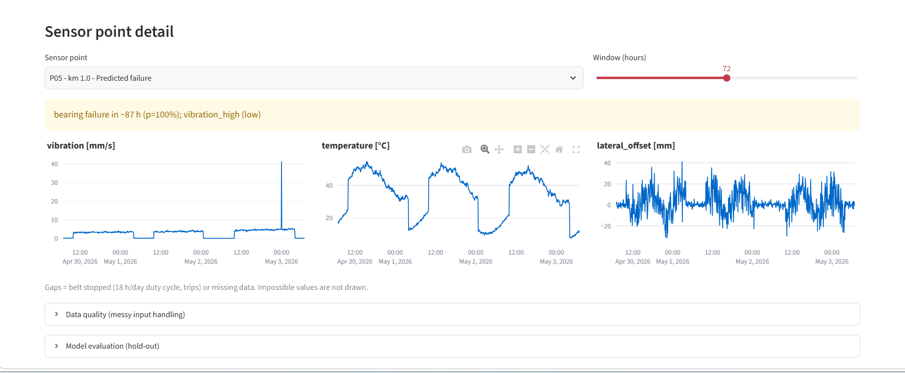
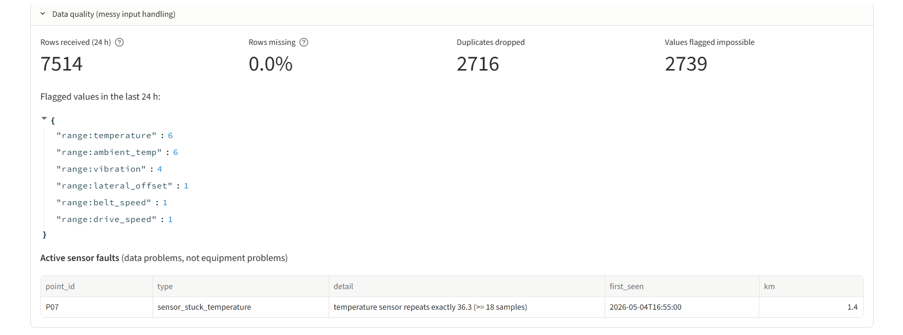

# Mining conveyor belt - health monitoring and failure prediction

A small but complete system: **simulated sensors -> backend (store + analyse) -> prediction model ->
dashboard**, plus a **vision component** that finds wear and tear on the belt and copes with the fact that
the belt is a *loop*.

* Design document: **[docs/DESIGN.md](docs/DESIGN.md)** (what is monitored, how, why; read it second)
* Plain-language walkthrough for newcomers (examples, libraries, model, run steps, how to present it):
  **[docs/EXPLAIN_PROJECT.txt](docs/EXPLAIN_PROJECT.txt)**
* AI chat logs: [ai_usage/](ai_usage/)

```
 simulator ──POST /readings──▶ FastAPI backend ──▶ SQLite ──▶ analysis (anomalies, predictions) ─┐
 (26 sensor suites, messy)       validate / flag /                                               ├─▶ Streamlit dashboard
                                 de-duplicate                                                    │
 public belt images ─▶ vision detector ─▶ POST /vision/observations ─▶ loop-aware tracker ───────┘
```

> **Status, honestly.** This repository was written without being able to install packages in the
> authoring environment, so the numeric / ML / UI code has **not been executed yet** by its author. It was
> syntax-checked and statically checked (no undefined names, all imports and config keys resolve), and the
> standard-library parts - database schema and the vision tracker (12 unit tests) - were run. Run
> the steps below; anything that breaks is a bug to fix, not a feature. The "Results" and "Screenshots"
> sections contain marked placeholders instead of invented numbers.

---

## 1. Quick start (VS Code, step by step)

Everything runs from the folder `ai_conveyor_belt/` with the Python environment that is already there
(`.venv`). No Python version is installed by anything in this repo.

**Step 0 - open and select the interpreter.** In VS Code: *File -> Open Folder* -> `ai_conveyor_belt`.
`Ctrl+Shift+P` -> *Python: Select Interpreter* -> `.venv/bin/python`. Open a terminal (`Ctrl+\``) - it
activates the environment. (WSL: use the *WSL* remote window; ports 8000/8501 are forwarded automatically.)

**Step 1 - install the libraries** (numpy, pandas, scikit-learn, fastapi, uvicorn, streamlit, plotly, pillow, ...):

```bash
pip install -r requirements.txt
```

**Step 2 - create the history and train the models** (about 1-3 minutes):

```bash
python scripts/bootstrap.py            # or: python scripts/bootstrap.py --days 60   (faster)
```

What happens: the simulator generates 120 days of 5-minute readings for 26 sensor points (with missing
values, stuck sensors, impossible values, duplicates, shuffled order), the data goes through the same
ingestion code the API uses into `data/belt.db`, work orders of repaired failures are stored, the baseline
and the failure predictor are trained with a time-based hold-out evaluation (printed, and saved to
`data/models/metrics.json`), and a first analysis runs. Four faults are deliberately "in progress" at the
end of the history, so the dashboard shows something immediately.

**Step 3 - vision model.** Put your public dataset in `data/vision_dataset/<class>/*.jpg` (see
[Vision dataset](#4-vision-dataset)) and train:

```bash
python -m belt.vision.train
```

No dataset yet? Use the offline **stand-in** (procedural images, *not* for submission) to try the pipeline:

```bash
python -m belt.vision.train --synthetic
```

**Step 4 - start everything:**

```bash
python scripts/start_all.py            # API + live sensor stream + dashboard, Ctrl+C stops all
```

or in three terminals (also available as VS Code *Run and Debug* entries, see `.vscode/launch.json`):

```bash
python -m uvicorn belt.api.main:app --port 8000     # backend, docs at http://localhost:8000/docs
python -m belt.simulator.live                       # live stream, 30 simulated minutes per second
python -m streamlit run belt/dashboard/app.py       # dashboard at http://localhost:8501
```

**Step 5 - watch the belt loop** (in another terminal; needs step 3):

```bash
python -m belt.vision.run_loop --laps 6 --lap-delay 2
```

It prints, per lap, how many frames were analysed and what the tracker did with them, and at the end the
score: *raw defect detections vs. unique defects vs. defects actually placed on the belt*.

**Step 6 - tests:**

```bash
python -m unittest discover -s tests -t . -v        # fast; slow end-to-end:  RUN_SLOW=1 python -m unittest tests.test_analysis -v
```

Order matters only for steps 2 -> 4; the API can be started before bootstrap, it just shows "database empty".

---

## 2. How it works, step by step

1. **Simulator** (`belt/simulator`) - for any timestamps it returns one row per sensor point: vibration,
   bearing temperature, lateral belt offset, ambient temperature, and at the drive station belt/drive speed,
   load, motor current, voltage. A healthy belt depends on load, ambient temperature and an 18 h/day duty
   cycle. Faults (bearing, mistracking, slip, overload, undervoltage) follow degradation curves in which
   *vibration rises first and temperature last*. Garbage is injected on purpose.
2. **Ingestion** (`belt/ingest.py`, `POST /readings`) - rows with unknown point or unparsable time are
   rejected and counted; impossible/non-numeric values are kept raw but flagged; duplicates are ignored
   (primary key = point + time); out-of-order is harmless.
3. **Baseline** (`analysis/prepare.py`) - for each channel and point the *expected* value given load and
   ambient temperature is learned from history (robust regression). Residual = observed - expected.
4. **Anomalies** (`analysis/anomaly.py`) - the median of the last hour of residuals must exceed 4 robust sigma
   **and** a practical minimum in the bad direction. Stuck or silent sensors are reported as *sensor* faults,
   not equipment faults. Output: location, type, severity.
5. **Prediction** (`analysis/features.py`, `predictor.py`) - residual features over 6/24/72 h per point ->
   gradient boosting: *what* may fail (5 modes), *how likely*, and *when* (median ETA + 20-80 % band).
6. **Status** - each point is `normal`, `abnormal` (active anomaly) or `predicted_failure` (model probability
   >= 50 %).
7. **Vision** (`belt/vision`) - features -> classifier per frame -> tracker that turns frames into *physical
   defects on the loop* (section 5).
8. **Dashboard** (`belt/dashboard/app.py`) - the four required views plus point detail, data quality, metrics.

---

## 3. Design decisions

| Decision | Why | Alternative I did not take |
|---|---|---|
| Sensor point every 200 m, drive-only channels at the head | realistic: drive electricals exist once; idlers carry vibration/temperature/offset | identical sensors everywhere (simpler, less realistic) |
| Compare against a **learned load-aware baseline**, not fixed limits | 3.5 mm/s is normal at peak load and alarming at half load; avoids false alarms | static thresholds (kept only for a few safety rules) |
| Median over ~1 h + both a z-score and a practical minimum | spikes can't alarm; tiny but "significant" shifts can't alarm | single-sample thresholds |
| Sensor faults are their own anomaly type | a flat-lined thermometer is not an overheating bearing | treating everything as equipment |
| Labels from a **work-order log**, not the simulator's hidden schedule | mirrors reality (maintenance records); keeps the backend honest about what it knows | reading the answer key |
| Per-mode "observable window" labels | a failure is only predictable while its signature exists (overload: ~hours, bearing: days) | one fixed horizon for all modes |
| Time-based evaluation + purge gap + naive-rule baseline | random splits leak between near-identical snapshots; a baseline shows what ML adds | random 80/20 |
| HistGradientBoosting + quantile regressors | NaN-tolerant, no scaling, fast, gives an ETA band | deep nets (no data), single regressor (no uncertainty) |
| Classical image features + RandomForest | laptop CPU, no PyTorch, small datasets, swappable behind `DefectDetector` | fine-tuned CNN / YOLO (better, heavier - listed under "differently") |
| SQLite, FastAPI, Streamlit | one-file DB and three commands for a reviewer | PostgreSQL/Timescale, React |
| Everything tunable in `belt/config.py` | assumptions are visible and challengeable | constants scattered in code |

---

## 4. Vision dataset

> **TO CONFIRM BEFORE SUBMITTING:** the brief requires images from a public dataset, and "document where
> you got it and why you chose it". I could not download or inspect any dataset from the authoring
> environment, so **nothing below is verified**. Choose one, check its licence and labels, then replace this
> box with the final decision.

Candidates found by search (verify each):

| Candidate | What it is (per its page) | Concerns |
|---|---|---|
| [Object detection in iron ore conveyor belt systems (Kaggle)](https://www.kaggle.com/datasets/asfarhossainsitab/object-detection-in-iron-ore-conveyor-belt-systems) | 6.25 GB, ~69.6 k files, image + video folders incl. a YOLO set; Apache 2.0 | page has no description; unclear whether classes are belt *damage* or *objects on the belt* |
| Conveyor belt damage dataset described in [Applied Sciences 11(16):7282 (2021)](https://www.mdpi.com/2076-3417/11/16/7282) | 3000 images, 4 classes: surface wear, surface damage, breakdown, tear | the paper uses it; public availability and licence not verified |
| [Conveyor belt damage (Ultralytics platform)](https://platform.ultralytics.com/abhishek-singhania/datasets/conveyor-belt-damage) | mining-environment images annotated for damage, holes, tears (segmentation) | needs account/export; licence unverified |
| [Industrial Machinery Fault Image Dataset (Kaggle)](https://www.kaggle.com/datasets/zara2099/industrial-machinery-fault-image-dataset) | 234 images, folders crack / misalignment / normal / surface defects / wear incl. *conveyor rollers* | tiny; rollers, not belt surface |

Selection criteria I would apply: (1) shows the *belt surface* in a mining/industrial setting, (2) has a
**normal** class and tear/damage/wear classes, (3) licence allows use, (4) preferably frames from several
scenes so a scene-level split is possible (frames cut from one video leak between train and test).

**How to plug a dataset in**

* Folder-per-class: `data/vision_dataset/normal/*.jpg`, `.../tear/*.jpg`, `.../wear/*.jpg` ... Class names
  `normal`, `good`, `ok`, `healthy`, `no_defect`, `normal condition` count as normal; everything else is a defect type.
* YOLO-format download (images + `labels/*.txt`)? Convert with
  `python scripts/yolo_to_folders.py --src <download folder> [--names tear,damage,wear]` (empty label file =
  normal, otherwise the class of the largest box).
* Then `python -m belt.vision.train` (prints accuracy, per-class precision/recall, confusion matrix; saved to
  `data/models/vision_metrics.json`).

---

## 5. The looping belt (vision) - my reasoning

Full table in [docs/DESIGN.md section 8](docs/DESIGN.md#8-vision). The short version:

* The camera sees **the same belt metres every lap**. If every sighting were a "defect", one tear would
  become dozens a day. So a defect is identified by **where it sits on the loop** (position mod loop length ->
  10 m segment), not by when the picture was taken. Frames from different laps at the same place merge into one
  *track*.
* One frame covers ~2 m of a 10 m segment, so small defects are **only caught in some laps** (detections
  flicker). A track becomes *confirmed* after sightings in >= 2 *different* laps; a confirmed defect is never
  cleared by missed laps. An unconfirmed one is *dismissed* after 5 clean laps (ore lump, dust).
* **Splices** pass the camera every lap and look like defects: known splice positions are masked.
* **Bad frames** (blur, dark, glare) are logged but never count as evidence of a clean belt.
* Severity per lap is kept per track, so wear **growth** is visible.
* **Not solved, on purpose:** the underside (pulley side) is not inspected - one camera only; encoder drift
  and re-synchronisation on a splice are designed but not implemented; unknown splices would be confirmed
  as defects; site-specific lighting calibration; reported classifier accuracy is an upper bound because
  nearby frames leak.

`belt/vision/run_loop.py` simulates exactly these effects (laps, jittered frames, defects re-appearing,
splices, bad frames, encoder noise) against the real API, then scores the result (defects found vs placed).

---

## 6. Messy input - what the system does

| Mess | Handling | Where |
|---|---|---|
| missing readings / silent sensor | NULL, ignored; `sensor_offline` anomaly if > 50 % missing | `ingest.py`, `anomaly.py` |
| duplicates, out-of-order | primary key + sorted re-gridding; counted on the dashboard | `ingest.py`, `prepare.py` |
| impossible values | stored raw, flagged, excluded from analysis | `ingest.py` |
| stuck sensor | exact repetition >= 1.5 h while running -> sensor fault, samples excluded | `prepare.py`, `anomaly.py` |
| spikes | median over the last hour; features use clipped hourly means | `anomaly.py`, `features.py` |
| belt stopped (duty cycle, trips) | residuals only while running; "unknown" instead of "normal" | `prepare.py`, `anomaly.py` |
| component repaired | history of that point is cut at the repair (no ghost alarms) | `pipeline.py`, `features.py` |
| calibration drift | **not handled** (two simulated sensors drift +0.03 degC/day) | - |

---

## 7. Results (fill in after running)

After `python scripts/bootstrap.py` the hold-out evaluation is printed and saved to
`data/models/metrics.json`; the dashboard shows it in the *Model evaluation* expander. Paste the numbers here:

| | ML model | Naive rule (any channel >= 4 sigma) |
|---|---|---|
| Fault-level recall (faults announced before failing) | `TODO` | `TODO` |
| Median lead time before failure (h) | `TODO` | `TODO` |
| False-alarm episodes / 100 point-days | `TODO` | `TODO` |
| Snapshot precision / recall | `TODO` | `TODO` |

Vision: `data/models/vision_metrics.json` (per-class precision/recall) and the final lines of
`run_loop` (frames, raw detections, unique defects, confirmed & matched, confirmed but false).
`TODO`

Caveat to state once you have numbers: the model is trained and tested on **simulated** data, which proves
the pipeline and the evaluation logic, not real-world accuracy.

---

## 8. Dashboard screenshots

`TODO` - after Step 4/5 take screenshots and save them under `docs/screenshots/` with these names, then
uncomment the lines:

<!--




-->

---

## 9. What I would do differently / next

* **Real data first.** Everything is validated on simulated data. With real data the first week would go
  to the baseline (seasonality, ore types), to correcting the observable-window assumptions with reliability
  engineers, and to a labelled failure history instead of simulated work orders.
* **Vision:** fine-tune a CNN/YOLO with segmentation masks, calibrate severity against repair decisions,
  add a splice detector and encoder re-sync, a second camera for the pulley side, and forecast defect growth
  per track (the severity history is already stored).
* **Prediction:** calibrate probabilities, smooth over cycles (hysteresis), per-mode thresholds, model the
  cascades between points (a seized idler raises neighbours' vibration), retraining and drift monitoring.
* **Platform:** PostgreSQL/Timescale, a queue between simulator/edge and backend, authentication, Docker
  and a cloud deployment, alert delivery with acknowledgement.
* **Process:** this repository was produced without running the numeric code (see status box). The very
  first thing I would do is run it, read the hold-out report critically and fix what it exposes.

---

## 10. Repository layout

```
README.md  docs/DESIGN.md  ai_usage/  requirements.txt
belt/config.py                    all tunable assumptions
belt/simulator/                   layout, fault schedule, generator, live streamer
belt/db.py  belt/ingest.py        SQLite schema, validation + storage
belt/analysis/                    prepare (baseline, residuals), anomaly, features, predictor, train, pipeline
belt/api/main.py                  FastAPI backend
belt/vision/                      features, train, detector, tracker (loop logic), run_loop, synth (stand-in)
belt/dashboard/app.py             Streamlit dashboard
scripts/                          bootstrap, start_all, yolo_to_folders
tests/                            tracker (stdlib), simulator/ingest, analysis, optional slow end-to-end
.vscode/                          launch configurations
data/                             database, models, frames, dataset (generated / downloaded, git-ignored)
```

## 11. Troubleshooting

| Symptom | Fix |
|---|---|
| `ModuleNotFoundError: numpy` (or pandas, fastapi ...) | `pip install -r requirements.txt` in the `.venv` selected in VS Code |
| Dashboard says "Cannot reach the backend" | start the API (`python -m uvicorn belt.api.main:app --port 8000`) |
| Dashboard says "database is empty" | `python scripts/bootstrap.py` |
| `too few failures in the history` | use more days: `bootstrap.py --days 120` |
| Vision loop: `No such file ... vision_model.joblib` | `python -m belt.vision.train` (or `--synthetic`) first |
| `pip` fails with `CERTIFICATE_VERIFY_FAILED` (corporate proxy) | configure your company's CA / index mirror for pip; do not disable TLS verification |
| Port already in use | `start_all.py --api-port 8001 --dashboard-port 8502` |
| Start over | stop everything, delete `data/belt.db*`, run `bootstrap.py` again (it recreates the database) |

## 12. Sources used for the failure-mode research

[Canadian Mining Journal - belt tracking](https://www.canadianminingjournal.com/featured-article/feeling-centered-the-zen-of-conveyor-belt-tracking/) ·
[Australian Bulk Handling Review - problems with belts in operation](https://www.bulkhandlingreview.com.au/problems-with-belts-in-operation/) ·
[Idler failure types (Vale data, ~98 k rollers)](https://www.metallum.com.br/24cbecimat/anais/PDF/IVd18-001.pdf) ·
[TMKS - tear causes](https://www.t-mks.com/en/solutions/conveyor-belt-longitudinal-tear-prevention-solutions/) ·
[Idler condition-based monitoring review](https://itecsu.com/resources/idler-condition-based-monitoring-systems-review/) ·
[MDPI - NDT for conveyor belt monitoring](https://www.mdpi.com/2076-3417/15/24/13272) ·
[Applied Sciences 11(16):7282 - belt damage detection](https://www.mdpi.com/2076-3417/11/16/7282)
