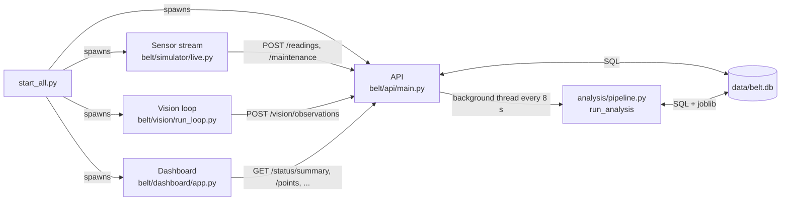

# Code flow - what runs, in which order, in which file

This document follows the code the way the computer does: you type a command, Python starts, and one file
calls the next. Everything below was read from the real source; function names are exact so you can search
for them (`Ctrl+Shift+F` in VS Code).

Contents

1. [The 30-second picture](#1-the-30-second-picture)
2. [What happens when you run `python scripts/start_all.py --vision`](#2-what-happens-when-you-run-python-scriptsstart_allpy---vision)
3. [Process 1 - the API (`belt/api/main.py`)](#3-process-1---the-api)
4. [Process 1b - the background analysis cycle](#4-process-1b---the-background-analysis-cycle-the-heart-of-the-project)
5. [Process 3 - the live sensor stream (`belt/simulator/live.py`)](#5-process-3---the-live-sensor-stream)
6. [Process 4 - the vision loop (`belt/vision/run_loop.py`)](#6-process-4---the-vision-loop)
7. [Process 2 - the dashboard (`belt/dashboard/app.py`)](#7-process-2---the-dashboard)
8. [One 30-minute chunk of data, end to end](#8-one-30-minute-chunk-of-data-end-to-end)
9. [The other entry points: `bootstrap.py`, vision training, tests](#9-the-other-entry-points)
10. [Who writes / reads which database table](#10-who-writes--reads-which-database-table)
11. [Where to change what](#11-where-to-change-what)
12. [How to follow the flow yourself (debugger, logs)](#12-how-to-follow-the-flow-yourself)

---

## 1. The 30-second picture

`start_all.py` does **not** contain any business logic. It only starts four separate programs
("processes") and keeps them alive. The programs talk to each other over HTTP and through one SQLite file.

```
python scripts/start_all.py --vision
   |
   |-- starts  [1] API        uvicorn belt.api.main:app      (port 8000)  <- the hub, owns the database
   |-- starts  [2] Dashboard  streamlit run belt/dashboard/app.py  (port 8501)  -> reads from [1]
   |-- starts  [3] Sensors    python -m belt.simulator.live          -> POSTs readings to [1]
   |-- starts  [4] Camera     python -m belt.vision.run_loop         -> POSTs detections to [1]
   |
   '-- waits (sleep loop) until you press Ctrl+C, then stops all four
```



Important idea: **the dashboard never touches the database.** It only calls the API. The simulator and the
camera never touch the database either; they also only call the API. Only the API process (and the one-time
scripts `bootstrap.py` / training) open `data/belt.db`.

---

## 2. What happens when you run `python scripts/start_all.py --vision`

File: `scripts/start_all.py` (about 75 lines). Python executes it top to bottom:

| Step | Code (in `start_all.py`) | What it does |
|---|---|---|
| 1 | `import argparse, os, subprocess, sys, time, requests` | Only standard library + `requests`. It imports **nothing** from the `belt` package. |
| 2 | `ROOT = Path(__file__).resolve().parent.parent` | Project folder (`ai_conveyor_belt/`). |
| 3 | `PY = sys.executable` | The exact Python that is running now (your `.venv/bin/python`). Child programs reuse it, so they all see the same installed libraries. |
| 4 | `if __name__ == "__main__": main()` | Entry point. |
| 5 | `main()` -> `argparse` | Reads `--speed` (default 30 simulated minutes per real second), `--vision`, `--api-port 8000`, `--dashboard-port 8501`. |
| 6 | `env = dict(os.environ, BELT_API_URL=api, PYTHONPATH=str(ROOT))` | Environment for the children. `PYTHONPATH=ROOT` is what lets `python -m belt.api...` find the `belt` package. `BELT_API_URL` tells every child where the API is (`belt/config.py` and `dashboard/app.py` read it). |
| 7 | inner function `spawn(name, cmd)` | Prints "starting ...", runs `subprocess.Popen(cmd, cwd=ROOT, env=env)` and remembers the process in the list `procs`. |
| 8 | `spawn("API", [PY, "-m", "uvicorn", "belt.api.main:app", "--port", ...])` | **Starts process 1** (details in section 3). |
| 9 | `for _ in range(60): requests.get(api + "/health")` | Polls the API's `/health` endpoint up to 60 times, 1 s apart, until it answers. (If it never answers, the script continues anyway after about 2 minutes.) This is why the others start only when the API is ready. |
| 10 | `spawn("dashboard", [PY, "-m", "streamlit", "run", "belt/dashboard/app.py", "--server.port", ..., "--server.headless", "true"])` | **Starts process 2** (section 7). Headless = do not try to open a browser by itself. |
| 11 | `spawn("sensor stream", [PY, "-m", "belt.simulator.live", "--minutes-per-second", "30"])` | **Starts process 3** (section 5). |
| 12 | `if args.vision: spawn("vision loop", [PY, "-m", "belt.vision.run_loop", "--laps", "8", "--lap-delay", "3"])` | **Starts process 4** (section 6) - only because you passed `--vision`. |
| 13 | prints the two URLs | `Dashboard: http://localhost:8501`, `API docs: http://127.0.0.1:8000/docs`. |
| 14 | `while True: time.sleep(1)` + `p.poll()` | Idle loop. Every second it checks the API process; if the API died with an error it raises `SystemExit("API process exited")`. |
| 15 | `except KeyboardInterrupt` / `finally:` | On Ctrl+C: `terminate()` every child, wait up to 10 s, then `kill()` the stubborn ones. |

So the answer to "which files are hit when I run start_all.py" is: **`start_all.py` itself runs, then four
child programs start, and *they* pull in everything else.** The table below lists, per process, the files that
get imported and used.

| Process | Entry file | Files it imports / uses |
|---|---|---|
| 1 API | `belt/api/main.py` | `belt/config.py`, `belt/db.py`, `belt/ingest.py`, `belt/simulator/layout.py`, `belt/vision/tracker.py`, `belt/analysis/pipeline.py` -> which imports `belt/analysis/prepare.py`, `anomaly.py`, `features.py`, `predictor.py` |
| 2 Dashboard | `belt/dashboard/app.py` | only `requests`, `streamlit`, `plotly`, `pandas` (**no** `belt.*` imports; it talks over HTTP) |
| 3 Sensor stream | `belt/simulator/live.py` | `belt/config.py`, `belt/simulator/generator.py` -> `layout.py`, `faults.py` |
| 4 Vision loop | `belt/vision/run_loop.py` | `belt/config.py`, `belt/vision/detector.py` -> `features.py`; `belt/vision/train.py` (only `list_dataset`), `synth.py` (`add_splice_band`), `tracker.py` (`near_splice`) |

Files that **do not** run at all during `start_all.py`: `scripts/bootstrap.py`, `belt/analysis/train.py`,
`belt/vision/train.py` (as a program), everything in `tests/`. Those were run earlier, one time, to create
`data/belt.db` and the model files that the API and camera now load.

---

## 3. Process 1 - the API

Command run by `start_all.py`: `python -m uvicorn belt.api.main:app --port 8000`.
Meaning: "start the uvicorn web server and load the variable `app` from the module `belt.api.main`."

### 3.1 Module import (happens once, when uvicorn loads `belt/api/main.py`)

In this order:

1. `from .. import config` -> `belt/config.py` runs (only constants and paths: `DB_PATH`, `LIMITS`, `ANOMALY_RULES`, ...).
2. `from ..analysis.pipeline import run_analysis` -> `pipeline.py` imports `prepare.py`, `anomaly.py`,
   `features.py`, `predictor.py` (that is where scikit-learn, pandas, numpy are loaded).
3. `from ..db import connect, get_meta, init_db, upsert_points` -> `belt/db.py`.
4. `from ..ingest import add_maintenance, ingest_records` -> `belt/ingest.py`.
5. `from ..simulator.layout import POINTS, POINT_BY_ID` -> the 26 sensor points are built once, in memory.
6. `from ..vision import tracker` -> `belt/vision/tracker.py`.
7. `app = FastAPI(..., lifespan=lifespan)` creates the web app; CORS middleware added.
8. Each `@app.get(...)` / `@app.post(...)` decorator **registers** a URL -> function mapping (nothing runs yet).
9. Last lines: create `data/vision_frames/` if missing and mount it as static files under `/vision/frames`.

### 3.2 Startup (the `lifespan` function - runs once when the server is ready)

```
lifespan(app):
    conn = connect()                  # db.py: opens data/belt.db, WAL mode, row_factory=sqlite3.Row
    init_db(conn)                     # db.py: executescript(SCHEMA)  -> CREATE TABLE IF NOT EXISTS ...
    upsert_points(conn, POINTS)       # db.py: writes the 26 sensor points into table `points`
    conn.close()
    t = threading.Thread(target=_analysis_loop, ...)   # starts the BACKGROUND ANALYSIS THREAD
    t.start()
    yield                             # <- the server now serves requests
    stop.set()                        # on shutdown: tells the thread to stop
```

From now on **two things happen concurrently inside the API process**:

- **Request handling** - FastAPI calls one of the endpoint functions per HTTP request (section 3.3).
- **A background thread** - `_analysis_loop` wakes up every `config.ANALYSIS_INTERVAL_S` = 8 seconds and
  calls `run_analysis(conn)` (section 4).

### 3.3 Endpoints: which function runs for which URL

Every endpoint that needs the database has `conn=Depends(get_db)`. FastAPI then calls `get_db()` first, which
does `conn = connect()`, hands it to the endpoint, and `conn.close()` afterwards.

| Request | Function in `main.py` | Calls | Reads/writes |
|---|---|---|---|
| `GET /health` | `health` | - | returns `{"status": "ok"}` (used by `start_all.py` and `live.py` to wait for the API) |
| `POST /readings` | `post_readings` | `ingest.ingest_records` -> `ingest_frame` | writes `readings`, `meta` |
| `POST /maintenance` | `post_maintenance` | `ingest.add_maintenance` | writes `maintenance_log` |
| `POST /analysis/run` | `post_analysis` | `pipeline.run_analysis(force=True)` | manual trigger |
| `GET /status/summary` | `status_summary` | `get_meta`, `tracker.summary` | reads `point_status`, `anomalies`, `readings`, `meta`, vision tables |
| `GET /points` | `get_points` | - | reads `point_status`, `predictions`, `points`, newest row of `readings` |
| `GET /points/{id}/series` | `get_series` | - | reads `readings` (skips flagged values) |
| `GET /anomalies` | `get_anomalies` | - | reads `anomalies` joined with `points` |
| `GET /predictions/latest` | `get_predictions` | - | reads `predictions` (latest `run_ts`) |
| `GET /data-quality` | `data_quality` | `get_meta` | reads `readings`, `anomalies`, `meta` |
| `POST /vision/observations` | `post_observations` | `tracker.record_batch` | writes `vision_observations`, `vision_tracks` |
| `GET /vision/tracks`, `/vision/summary` | `get_tracks`, `get_vision_summary` | `tracker.list_tracks`, `tracker.summary` | reads vision tables |
| `POST /vision/reset` | `post_vision_reset` | `tracker.reset_vision` | clears vision tables |
| `POST /vision/tracks/{id}/repair` | `post_track_repair` | `tracker.mark_repaired` | updates `vision_tracks` |
| `GET /vision/frames/<file>.jpg` | static files | - | serves thumbnails from `data/vision_frames/` |

### 3.4 Worked example: `POST /readings` (what the sensor stream calls every second)

```
HTTP body: {"readings": [ {"point_id":"P12","ts":"2026-05-01T10:00:00","vibration":2.4, ...}, ... 156 rows ]}

1. FastAPI parses the body into ReadingsIn (readings: list[dict] - deliberately lenient)
2. get_db()                      -> db.connect()
3. post_readings(body, conn)     -> ingest.ingest_records(conn, body.readings)
4.   ingest_records              -> builds a pandas DataFrame, calls ingest_frame(conn, df)
5.   ingest_frame (ingest.py), in this order:
       a. missing columns are added as NaN
       b. unknown point_id or unparseable timestamp -> row REJECTED (counted)
       c. timestamps -> UTC -> text "YYYY-MM-DDTHH:MM:SS"
       d. for every channel: not a number -> flag "bad_type:<channel>;"
                             outside config.LIMITS -> flag "range:<channel>;" (raw value kept)
       e. INSERT OR IGNORE INTO readings (...) VALUES (...)      <- primary key (point_id, ts)
          => a duplicate row is silently ignored and counted as "duplicates"
       f. _totals_update -> meta["ingest_totals"] += this batch
6. returns {"received":156, "inserted":156, "duplicates":0, "rejected":0, "flagged":1}
7. FastAPI sends this as JSON; live.py prints it ("sent 156 rows: inserted=156 ...")
```

---

## 4. Process 1b - the background analysis cycle (the heart of the project)

Thread started in `lifespan`, defined in `belt/api/main.py`:

```
_analysis_loop(stop):
    while not stop.wait(config.ANALYSIS_INTERVAL_S):     # every 8 s
        conn = connect()
        run_analysis(conn)                               # belt/analysis/pipeline.py
        conn.close()                                     # exceptions are logged, the loop keeps going
```

`run_analysis(conn, force=False)` in `belt/analysis/pipeline.py`, step by step. It runs inside a lock
(`_lock`) so two analyses cannot run at once.

| # | Line of logic | File / function | Explanation |
|---|---|---|---|
| 1 | `SELECT MAX(ts) FROM readings` | `pipeline.run_analysis` | "now" = timestamp of the newest reading (not the wall clock). No data -> returns `no_data`. |
| 2 | `if get_meta(conn,"analysis_last_ts") == last: return "up_to_date"` | same | Nothing new since last time -> skip (cheap). |
| 3 | `baseline = get_meta(conn, "baseline")`; `predictor = _predictor()` | `db.get_meta`, `pipeline._predictor` | The baseline (JSON in table `meta`) and the trained model (`data/models/predictor.joblib`, cached by file modification time). Either missing -> `not_trained`. Both are created by `bootstrap.py`. |
| 4 | `load_readings(conn, since=last-100h)` | `prepare.load_readings` | SQL `SELECT * FROM readings WHERE ts >= ? ORDER BY ts`, read in chunks of 200 000 rows into a pandas DataFrame. |
| 5 | `to_wide(df)` | `prepare.to_wide` | Flagged values -> NaN. For every channel `pivot` to a table "time x sensor point", resample to a regular 5-minute grid. Derives `slip = 1 - belt_speed/drive_speed`. Calls `infer_running` to get a True/False per timestamp "belt is moving" (drive speed above `RUNNING_SPEED_THRESHOLD`; fallback: median vibration). Returns a `Wide` object. |
| 6 | `analyse(wide, baseline)` | `prepare.analyse` | For each (channel, point) in the baseline: build the *expected* value `intercept + coef*load (+ ambient)`, compute `delta = measured - expected` and `z = delta / sigma`, **only where the belt runs and the sensor is not stuck** (`stuck_mask`). Result: `Analysis` with tables `delta`, `z`, `expected`, `stuck`. |
| 7 | `resets_from_db` + `mask_before_reset` | `pipeline` | Repairs from `maintenance_log`. Everything measured before a point's last repair is set to NaN, so the old broken part cannot trigger alarms on the new one. |
| 8 | `detect_equipment(an)` + `detect_sensor_faults(an)` | `anomaly.py` | **Anomaly detection**, see 4.1. Returns a list of dicts `{point_id, type, state: active/normal/unknown, severity, ...}`. |
| 9 | `apply_anomalies(conn, results, last)` | `pipeline` | Opens new rows in table `anomalies` (status `active`), updates still-active ones, marks `normal` ones `resolved`. `unknown` ones are left alone. |
| 10 | `apply_maintenance(conn, last)` | `pipeline` | A completed repair resolves equipment anomalies of that point that existed before the repair. |
| 11 | `predict_now(an, predictor, last, resets)` | `pipeline` -> `features.hourly_badness`, `features.build_features`, `predictor.predict` | **Failure prediction**, see 4.2. |
| 12 | `store_predictions(conn, rows, last)` | `pipeline` | Writes one row per point into table `predictions` (keeps 3 days). |
| 13 | `update_status(conn, rows, last)` | `pipeline` | One status per point into `point_status`: `normal` -> `abnormal` if it has an active anomaly -> `predicted_failure` if the model says p >= 0.5 (this overrides). |
| 14 | `set_meta(... "analysis_last_ts" ...)`, `"belt_running"` | `db.set_meta` | Remembers progress. Returns `{"status":"ok", "anomaly_checks": N, "predicted_failures": K}`. |

### 4.1 `detect_equipment` (belt/analysis/anomaly.py)

For every rule in `config.ANOMALY_RULES` (7 channels) and every sensor point (drive-only channels only for P00):

1. take the z-scores `an.z[channel][point]`; `valid` = indices with a finite value;
2. "fresh enough" = at least `ANOMALY_MIN_VALID` (8) valid samples **and** the newest is not older than
   `ANOMALY_STALE_HOURS` (3 h). Not fresh -> state **`unknown`** (belt stopped or sensor silent; we do not say
   "normal");
3. take the last `ANOMALY_WINDOW` (12, about 1 hour) valid samples, compute the **median** z and median delta;
4. orient by direction (+1 higher is bad, -1 lower is bad, 0 both);
5. if the oriented median z >= `ANOMALY_Z` (4.0): severity = `severity_for(channel, amount)` against that
   channel's thresholds (low / medium / high / critical). Below the first threshold -> no anomaly;
6. absolute safety rules (`temperature > 85`, `lateral_offset > 140` in the last 3 raw samples) are checked
   independently of the baseline;
7. result: `active` (with severity), or `normal`.

`detect_sensor_faults` adds `sensor_offline` (more than half of the last 12 samples missing) and
`sensor_stuck_<channel>` (the stuck mask from step 6 is true for the newest running sample).

### 4.2 `predict_now` (the ML part)

```
predict_now(an, predictor, now, resets):
    hourly = features.hourly_badness(an.z)
         # z-scores clipped to +-30, sign-oriented so "bigger = worse", averaged per hour
    t = an.wide.idx[-1]                             # the newest timestamp = the one snapshot we need
    feat = features.build_features(hourly, [t], resets)
         # one row per point = 57 numbers (7 channels x windows 6/24/72 h x mean,max + 24/72 h trends + is_drive)
         # history before the point's last repair is ignored
    pred = predictor.predict(feat)                  # belt/analysis/predictor.py
         # classifier.predict_proba  -> p_none, p_bearing, p_mistrack, p_slip, p_overload, p_undervoltage
         # p_fail = 1 - p_none ; mode = most likely failure class
         # three quantile regressors -> eta_low_h, eta_h, eta_high_h (20 / 50 / 80 %)
    level = "predicted_failure" if p_fail >= 0.50 (config.P_PREDICTED_FAILURE)
            "watch"             if p_fail >= 0.30 (config.P_WATCH)
            "none"              otherwise
    evidence = predictor.evidence(row, mode)        # e.g. "vibration +6.2 sigma (6h mean); temperature +1.1 sigma"
```

The model files are loaded, not trained, here. Training happened once in `bootstrap.py` -> `train_all`.

---

## 5. Process 3 - the live sensor stream

Command: `python -m belt.simulator.live --minutes-per-second 30`. File: `belt/simulator/live.py`.

```
main():
  1. argparse                                   --api, --minutes-per-second, --max-hours
  2. sim = BeltSimulator.from_config()          generator.py: reads data/sim_config.json
                                                (written by bootstrap) -> same seed, same fault schedule
                                                => without that file the stream cannot continue the same belt
  3. wait_for_api(api)                          polls GET /health
  4. summary = GET /status/summary              -> last_data_ts = where the stored history ended
  5. cursor = last_data_ts + 5 min              (falls back to sim.demo_now)
  6. while cursor < sim.end:                    # sim.end = demo_now + 40 days of simulated time
       step = 30 simulated minutes              # (--minutes-per-second 30 -> 6 samples per point)
       ts   = sim.timestamps(cursor, cursor+step)
       df   = sim.generate(ts)                  # generator.py, see 5.1
       POST /readings   _records(df, rng)       # rows shuffled (out-of-order), timestamps as text,
                                                # NaN -> null
       due = sim.maintenance_between(...)       # failures whose repair finished in this chunk
       if due: POST /maintenance                # "work order" arrives like from a maintenance system
       print "[2026-05-01 18:30] sent 156 rows: inserted=... duplicates=... flagged=..."
       cursor += step
       sleep so that one loop takes about 1 real second
```

At the default speed 40 simulated days take about 32 real minutes (40 x 24 x 60 / 30 = 1,920 s); then the stream stops by itself
(`cursor >= sim.end`). The API and dashboard keep running.

### 5.1 `BeltSimulator.generate(ts)` (belt/simulator/generator.py)

1. `rng` seeded with `[seed, first timestamp]` -> **deterministic**: the same chunk always produces the same numbers.
2. Operating state per timestamp: scheduled stop 04:00-10:00, plus "down" after each fault's `failure_time`
   for `repair_hours` -> `running` array.
3. Context: ambient temperature (daily + weekly sine, minus elevation effect), belt load (slow sines + noise),
   an imbalance sine.
4. Healthy signals for all 26 points at once (numpy arrays shaped time x points):
   `vib = 1.8 + 0.0003*load + point_bias + noise`, `temp = ambient + 14 + 0.0025*load + ...`,
   `lateral_offset = noise*(10 + 6*curve) + imbalance + bias`; drive point: speed, current, voltage, load.
5. For every fault in `self.faults` (from `faults.build_schedule`): inside its `lead_hours` window add the
   mode's signature (bearing: vibration `+12*exp(-tau/(0.2*L))` early, temperature `+52*st^2` late; mistrack:
   offset `+-160*s^1.5`; slip / overload / undervoltage: drive-point channels).
6. `_apply_messy(...)`: sensor outages, stuck values, drift, spikes (x4-x9), impossible values, 1.2 % missing.
7. Flatten to a long table (`point_id, ts, <9 channels>`), drop rows where the whole suite is offline, add
   0.3 % duplicate rows. This is the DataFrame that `live.py` sends.

---

## 6. Process 4 - the vision loop

Command: `python -m belt.vision.run_loop --laps 8 --lap-delay 3`. File: `belt/vision/run_loop.py`.

```
main() -> run(args):
  1. detector = DefectDetector()                  detector.py: joblib.load(data/models/vision_model.joblib)
                                                  (created by `python -m belt.vision.train`)
  2. list_dataset(...)                            train.py: images grouped by class folder
     build_belt(...)                              12 hidden "true defects" at random places on the 10 km loop
     write data/vision_truth.json                 (answer key, used only for the final score)
  3. POST /vision/reset                           clears earlier vision results (unless --keep)
  4. for lap in 1..8:
       for each of the 1000 segments (10 m each):
            center = segment start + random offset
            if a true defect is within reach  -> use that defect's image
            else                              -> a random normal image
            near a known splice               -> synth.add_splice_band(image)
            photometric(...)                  -> brightness +-15 %, noise, dust specks,
                                                 4 % of frames blurred or darkened ("bad frames")
       results = detector.analyse_batch(images)       # 128 at a time, see 6.1
       payload = [{frame_id, lap, position_m (+1 m encoder noise), label, score, severity,
                   quality_ok, bbox, image_file}, ...]
                 (a thumbnail is saved to data/vision_frames/ for every accepted defect detection)
       POST /vision/observations  (250 per request)   -> API -> tracker.record_batch
       sleep 3 s between laps
  5. score_run(): GET /vision/summary + /vision/tracks and prints
        "confirmed & matched 11 / 12", "confirmed but no real defect 0"
```

### 6.1 `DefectDetector.analyse_batch(images)` (belt/vision/detector.py)

1. `features.compute(img)` per image (`belt/vision/features.py`): resize to 96x96, colour statistics,
   grey histogram, gradient histogram + edge density, local-binary-pattern texture histogram, 6x6 grid of
   brightness and gradient (about 143 numbers) - plus `brightness` and `sharpness`.
2. `clf.predict_proba(X)` (RandomForest from the joblib file): `score = 1 - P(normal)`.
3. `label` = the most probable defect class if `score >= DETECTION_THRESHOLD` (0.5), else "normal".
4. `_anomaly_map`: compares the 6x6 grid with the healthy reference -> `area` and a `bbox`.
5. `severity = 0.5*score + 0.5*min(1, 2.5*area)` for defect frames.
6. `_quality`: too dark / glare / blurred -> `quality_ok = False`.

### 6.2 What the API does with the observations (belt/vision/tracker.py)

`post_observations` -> `tracker.record_batch` -> `record_observation` for each frame, in this order:

1. missing field -> `rejected`; `frame_id` already stored -> `duplicate` (idempotent);
2. `seg = seg_of(position)` (10 m segment, wraps around the loop);
3. **`near_splice(pos, POSITION_ERROR_M)` -> outcome `ignored_splice`** (checked first, a splice is not a defect);
4. `quality_ok` false -> `low_quality` (bad frames are never evidence);
5. label not "normal" and score >= 0.5 -> `_on_defect`:
   - `_find_track(seg)`: an open track within +-1 segment? No -> new track, status `suspected`, outcome `new_track`.
   - Yes -> merge: label votes, severity history, `laps_seen += 1` only if this is a **new lap**;
     status becomes `confirmed` when `laps_seen >= CONFIRM_LAPS` (2) -> outcome `confirmed_now` / `merged`;
6. otherwise `_on_clean`: if an open track sits in this segment and was not already checked this lap, count a
   miss; a *suspected* track with `DISMISS_AFTER_MISSES` (5) clean laps becomes `dismissed`; a *confirmed*
   track is never cleared;
7. the frame itself is stored in `vision_observations` with its `outcome` and `track_id`.

The per-lap line printed by `run_loop` (`lap 3: 1000 frames -> {'clean': 946, 'low_quality': 44, ...}`) is
exactly the count of these outcomes.

---

## 7. Process 2 - the dashboard

Command: `python -m streamlit run belt/dashboard/app.py`. Streamlit runs `app.py` **from top to bottom on every
page load and every refresh**. There is no `main()`; the last lines trigger rendering.

Top of the file (runs first): imports, constants (`API = os.environ.get("BELT_API_URL", ...)`, colours,
units), `st.set_page_config(layout="wide")`, helper `api_get(path, **params)` (an HTTP GET with an error message
instead of a crash), `fetch_image(url)` (cached thumbnails). Then the sidebar: the `refresh` slider
(0 / 2 / 5 / 10 / 30 s, default 5) and the "Run analysis now" button (calls `POST /analysis/run`).

The last lines:

```python
frag = getattr(st, "fragment", None)
if frag is not None and refresh:
    frag(run_every=refresh)(render)()      # re-run render() every `refresh` seconds, without reloading the page
else:
    render()
```

`render()` (function near the bottom of `app.py`), in order:

| Order | Code | HTTP call | View function | Backend data |
|---|---|---|---|---|
| 1 | `summary = api_get("/status/summary")` | `GET /status/summary` | - | `point_status`, `anomalies`, `meta`, vision summary. `None` -> red message "Cannot reach the backend". Empty `last_data_ts` -> "run bootstrap first". |
| 2 | `kpis(summary)` | (uses `summary`) | `kpis` | the 6 top numbers and the anomaly-severity caption |
| 3 | "1. Status of every sensor point" | `GET /points` | `belt_map(points)` | Plotly chart: terrain line, one marker per point, colour by `status`, hover text with `reason`, `p_fail`, latest values |
| 4 | "2. Active anomalies" | `GET /anomalies` | `anomalies_table()` | table with location, type, severity |
| 5 | "3. Model predictions" | `GET /predictions/latest` | `predictions_table()` | table: where, what, probability bar, ETA with 20-80 % range |
| 6 | "4. Vision detections" | `GET /vision/summary`, `GET /vision/tracks` | `vision_panel(summary)` -> `loop_chart(tracks)` | 6 vision KPIs, polar chart of the 10 km loop, most severe detections with thumbnails (`/vision/frames/...`) |
| 7 | "Sensor point detail" | `GET /points/{id}/series` | `point_detail(points)` | time-series charts for the chosen point |
| 8 | expander "Data quality" | (summary) + `GET /data-quality` | `data_quality_panel` | ingest totals, flagged values, active sensor faults |
| 9 | expander "Model evaluation" | (summary `model_metrics`) | `metrics_panel` | the hold-out table written by `train_all` |

So when you see a **red point** on the map, the path was: analysis thread -> `update_status` -> table
`point_status` -> `GET /points` -> `belt_map`.

---

## 8. One 30-minute chunk of data, end to end

Follow a bearing fault at P12 that is just starting:

1. **`live.py`** `main` loop: `sim.generate(ts)` creates 6 timestamps x 26 points. For P12 the bearing fault adds
   about +1.5 mm/s to vibration. Messy rules may drop or spike some values.
2. `live.py` shuffles the rows and sends `POST /readings` (156 rows).
3. **`api/main.py`** `post_readings` -> **`ingest.py`** `ingest_frame`: checks, flags, `INSERT OR IGNORE`.
   The rows are now in `readings`.
4. Up to 8 seconds later the **analysis thread** wakes: `run_analysis` sees a newer `MAX(ts)`.
5. **`prepare.py`**: `load_readings` (last 100 h) -> `to_wide` -> `analyse`: P12 vibration z-score is, say, +5.
6. **`anomaly.py`** `detect_equipment`: median of the last 12 samples z >= 4 and delta >= 1.5 mm/s ->
   `active`, severity `low`. `apply_anomalies` inserts a row into `anomalies`.
7. **`features.py`** `hourly_badness` + `build_features`: P12's row now has `vibration_mean6` of about 5 and a
   rising `vibration_trend24`.
8. **`predictor.py`** `predict`: bearing probability climbs; once `p_fail >= 0.5` the level is
   `predicted_failure`, with an ETA band. `store_predictions` writes it, `update_status` turns P12 red.
9. The **dashboard** fragment fires (every 5 s): `GET /status/summary`, `GET /points`, `GET /predictions/latest`
   -> the map shows a red diamond at km 2.4 and the table shows "bearing, 99 %, ~7 days".
10. Later the temperature rises and the failure time passes. `live.py` posts the **work order**
    (`/maintenance` -> `add_maintenance` -> `maintenance_log`). The next `run_analysis` calls
    `apply_maintenance` (anomalies resolved) and `mask_before_reset` (old history ignored): P12 goes green.

Total path: `live.py` -> `api/main.py` -> `ingest.py` -> SQLite -> `pipeline.py` -> `prepare.py` ->
`anomaly.py` / `features.py` / `predictor.py` -> SQLite -> `api/main.py` -> `dashboard/app.py`.

---

## 9. The other entry points

These are **not** started by `start_all.py`; you run them once before.

### 9.1 `python scripts/bootstrap.py` (about 1 minute)

```
main():
  sim = BeltSimulator(seed=7, history_days=120)         generator.py (+ layout.py, faults.py)
  sim.save_config()                                     -> data/sim_config.json   (needed later by live.py)
  sim.save_ground_truth()                               -> data/ground_truth.json (answer key, never read by the backend)
  reset_db(); conn = connect(); init_db(conn); upsert_points(conn, POINTS)      db.py
  loop in 5-day chunks until sim.demo_now:
       df = sim.generate(sim.timestamps(t, t1))         generator.py
       df = df.sample(frac=1)                           shuffled = out-of-order delivery
       ingest_frame(conn, df)                           ingest.py  (same code the API uses)
  wo = sim.maintenance_between(...); add_maintenance(conn, wo)    -> 31 work orders = the labels
  train_all(conn)                                       analysis/train.py, see below
  run_analysis(conn, force=True)                        pipeline.py: first analysis so the dashboard is not empty
  prints "status: 4 point(s) predicted failure, ..." and the "Next:" hint
```

`train_all(conn)` (`belt/analysis/train.py`):

1. `load_readings` + `to_wide` for the whole history;
2. `fit_baseline(wide)` -> robust trimmed least squares per (channel, point); saved with `set_meta(conn, "baseline", ...)`;
3. `analyse` -> z-scores; `hourly_badness`;
4. snapshots every 3 h (`SNAPSHOT_STEP_H`), `build_features` (57 numbers each);
5. `label_snapshots(feat, failures)` using the work orders (`fetch_failures` reads `maintenance_log`):
   class and hours-to-failure; snapshots during repair downtime are invalid;
6. time split: train < t_split - 7 days, test >= t_split (70/30); the last 10 days are left out;
7. `FailurePredictor().fit(train)` -> `evaluate(test)` -> compares with the naive rule (`score_alerts`);
8. final model fitted on all labelled snapshots -> `final.save()` -> `data/models/predictor.joblib`;
9. metrics -> `set_meta(conn, "model_metrics", ...)` and `data/models/metrics.json`.

### 9.2 `python -m belt.vision.train [--synthetic]` (about 10 seconds)

`main()` -> optional `synth.generate_dataset(...)` (procedural stand-in images) -> `train(root)`:
`list_dataset` -> `extract` (`features.compute` per image) -> stratified 75/25 split -> `augment` /
`extract_augmented` (lighting, noise, dust) -> `RandomForestClassifier.fit` -> metrics on clean and augmented
hold-out -> final fit on everything -> `joblib.dump` of the model, the healthy reference grid and the frame-quality
thresholds -> `data/models/vision_model.joblib` and `vision_metrics.json`.

### 9.3 `python -m unittest discover -s tests -t .`

- `tests/test_tracker.py` - only `belt/vision/tracker.py` + `db.py` (in-memory SQLite, no extra libraries).
- `tests/test_simulator_and_ingest.py` - `generator.py`, `ingest.py`, `db.py`.
- `tests/test_analysis.py` - `prepare.py`, `features.py`, `anomaly.py`, `predictor.py`; the slow end-to-end test
  (`RUN_SLOW=1`) runs a 60-day version of bootstrap (seed 3) -> `train_all` -> `run_analysis`, then checks that P12
  (the pinned bearing fault) is `abnormal` or `predicted_failure`.

---

## 10. Who writes / reads which database table

| Table | Written by | Read by |
|---|---|---|
| `points` | `db.upsert_points` (API startup, bootstrap) | `api/main.py` (`/points`, joins) |
| `readings` | `ingest.ingest_frame` (via `POST /readings`, `bootstrap.py`) | `prepare.load_readings` (analysis, training), `/points`, `/points/{id}/series`, `/data-quality`, `/status/summary` |
| `maintenance_log` | `ingest.add_maintenance` (via `POST /maintenance`, `bootstrap.py`) | `train.fetch_failures`, `pipeline.resets_from_db`, `pipeline.apply_maintenance` |
| `anomalies` | `pipeline.apply_anomalies`, `apply_maintenance` | `pipeline.update_status`, `/anomalies`, `/status/summary`, `/data-quality` |
| `predictions` | `pipeline.store_predictions` | `/predictions/latest`, `/points` |
| `point_status` | `pipeline.update_status` | `/points`, `/status/summary` |
| `vision_observations` | `tracker.record_observation` | `tracker.summary` |
| `vision_tracks` | `tracker._on_defect`, `_on_clean`, `mark_repaired`, `reset_vision` | `tracker.list_tracks`, `tracker.summary` |
| `meta` (key/value JSON) | `set_meta`: `baseline`, `model_metrics` (train), `ingest_totals` (ingest), `analysis_last_ts`, `belt_running`, `maintenance_applied_id` (pipeline) | `get_meta` in pipeline and API |

Files besides the database: `data/models/predictor.joblib` (written by `train_all`, read by
`pipeline._predictor`), `data/models/vision_model.joblib` (written by `belt.vision.train`, read by
`DefectDetector`), `data/sim_config.json` (written by bootstrap, read by `live.py`),
`data/vision_frames/*.jpg` (written by `run_loop`, served by the API, shown by the dashboard).

---

## 11. Where to change what

| I want to... | Change this |
|---|---|
| change a threshold, window, port, path, number of sensor points | `belt/config.py` (one place for all tunables) |
| add a new failure mode to the simulator | `belt/simulator/faults.py` (`MODE_PARAMS`, schedule) + `generator.py` (signature) + `config.CLASSES` / `PREDICTION_WINDOW_H` / `ANOMALY_RULES` |
| change what counts as an anomaly or its severity | `config.ANOMALY_RULES`, `config.ANOMALY_Z`; logic in `belt/analysis/anomaly.py` |
| add or change model inputs | `belt/analysis/features.py` (`CH_FEATURES`, `FEATURE_NAMES`, `_point_features`) -> re-run `bootstrap.py` |
| swap the ML model | `belt/analysis/predictor.py` (`fit`, `predict`) - everything else only uses those two methods |
| change how bad data is handled | `belt/ingest.py` (flags, rejection), `prepare.to_wide` / `stuck_mask` |
| change how a defect becomes "confirmed" | `config.CONFIRM_LAPS`, `DISMISS_AFTER_MISSES`, `MERGE_RADIUS_SEGMENTS`; logic in `belt/vision/tracker.py` |
| use a real image dataset or a CNN | put images in `data/vision_dataset/<class>/`, re-run `belt.vision.train`; or replace the model inside `belt/vision/detector.py` (the rest uses only `analyse_batch`) |
| add a chart or table to the dashboard | `belt/dashboard/app.py`: write a view function, call it from `render()`; add an endpoint in `belt/api/main.py` if new data is needed |
| use real sensors instead of the simulator | stop `live.py`; send the same JSON to `POST /readings` |

---

## 12. How to follow the flow yourself

**Read the logs.** Everything `start_all.py` starts prints into the same terminal:

- `INFO: 127.0.0.1 - "POST /readings HTTP/1.1" 200 OK` - API received a request (process 1);
- `[2026-05-01 18:30] sent 156 rows: inserted=...` - sensor stream (process 3);
- `lap 3: 1000 frames in 2.6s -> {...}` - vision loop (process 4).

**Try the API by hand.** Open http://localhost:8000/docs, expand `GET /points`, click "Try it out". That is
exactly what the dashboard does.

**Run one analysis cycle without the server** (inside the activated `.venv`):

```bash
python - <<'EOF'
from belt.db import connect
from belt.analysis.pipeline import run_analysis
print(run_analysis(connect(), force=True))
EOF
```

**Step through with the VS Code debugger.** Open `belt/analysis/pipeline.py`, click left of the first line of
`run_analysis` to set a breakpoint, and start "Run and Debug" -> the bootstrap configuration (it calls
`run_analysis` at its end). Step into (`F11`) to follow `to_wide` -> `analyse` -> `detect_equipment`.

**Look at the database.** `python -c "import sqlite3; c=sqlite3.connect('data/belt.db'); print(c.execute('select point_id,status,reason from point_status').fetchall())"`.

**Reading order for a newcomer** (about 90 minutes): `config.py` -> `db.py` (just the `SCHEMA`) ->
`simulator/generator.py` (`generate`) -> `ingest.py` -> `analysis/prepare.py` -> `analysis/anomaly.py` ->
`analysis/features.py` -> `analysis/predictor.py` -> `analysis/pipeline.py` -> `api/main.py` ->
`dashboard/app.py` -> `vision/tracker.py` -> `vision/detector.py` -> `vision/run_loop.py` -> `scripts/start_all.py`.
